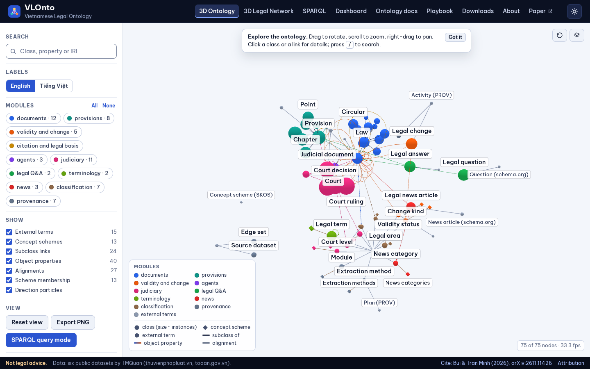
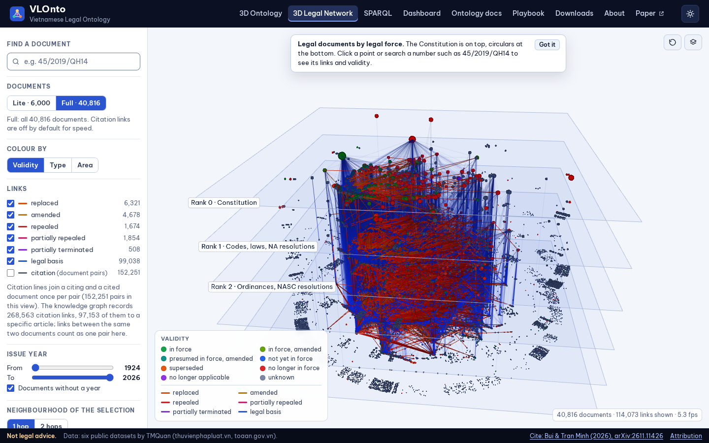

# VLOnto: Vietnamese Legal Ontology and Knowledge Graph

*Ontology và đồ thị tri thức pháp luật Việt Nam*

[3D Ontology Playground](https://tmquan.github.io/VLOnto/) · [3D Legal Network](https://tmquan.github.io/VLOnto/network-3d.html) ·
[SPARQL Playground](https://tmquan.github.io/VLOnto/sparql.html) · [Question Traces](https://tmquan.github.io/VLOnto/traces.html) · [Dashboard](https://tmquan.github.io/VLOnto/dashboard.html) · [Playbook (PDF)](https://tmquan.github.io/VLOnto/downloads/VLOnto-playbook.pdf)

**Paper:** [Vietnamese Legal Ontology: Every legal answer, traced to the article that grounds it](https://arxiv.org/abs/2611.11426)
(Khac-Hoai Nam Bui, Quan Tran Minh; arXiv:2611.11426, 2026). The approach is described in the paper; the numbers below
are computed from the VLOnto 0.1.0 release in this repository and can differ from the paper's.



VLOnto 0.1.0 is an OWL 2 ontology and a knowledge graph of Vietnamese law. It links legal documents, their
articles, the changes between documents (replacement, amendment, repeal), legal bases and citations, court decisions and
the provisions they apply, legal Q&As, legal terms and legal news. It is built from six public datasets on Hugging Face
and aligned to the European Legislation Identifier ontology (ELI), SKOS, PROV-O, schema.org, ORG and DCTERMS.

| Content | Count |
|---|---|
| Legal documents (10 normative types, from the Constitution to circulars) | 40,816 |
| Articles (main body 425,892, appendices 10,417) | 436,309 |
| Change events: replaced 6,321 / amended 4,678 / partially repealed 1,854 / repealed 1,674 / partially expired 508 | 15,035 |
| Legal-basis links / citation links | 99,038 / 268,563 |
| Court decisions / courts / applied-provision links | 1,544,091 / 1,345 / 7,060,655 |
| Case-to-case links / precedents | 14,650 / 28 |
| Legal Q&As (metadata and citation links) | 109,543 |
| Legal terms / legal news items | 16,701 / 681 |
| RDF triples in the full dump / in the browser subset | 31,516,606 / 49,923 |
| Ontology: classes, object properties, datatype properties, concept schemes | 47, 46, 35, 13 |

Validity of documents is derived as of 2026-11-08; it is unknown for 28,660 of
40,816 documents (no source status and no extracted change relation).

## Use it offline

The website is static and works without a server: clone or download this repository and open `site/index.html` (the
3D ontology playground) in a browser. Data is shipped as JavaScript files, the SPARQL engine (Oxigraph) runs as WebAssembly in the page, and fonts are
embedded, so nothing is fetched from the internet.

| Page | What it shows |
|---|---|
| `site/index.html` | 3D ontology playground (the landing page): classes, properties, concept schemes and external alignments; search, module filters, EN/VI labels, light/dark themes; SPARQL CONSTRUCT results drawn in 3D |
| `site/about.html` | overview of VLOnto, release numbers, paper and citation, licences |
| `site/network-3d.html` | 3D legal network: every document layered by legal force, with change, legal-basis and citation links and validity colours |
| `site/sparql.html` | SPARQL playground over the ontology and the browser subset of the graph, with bilingual example queries |
| `site/traces.html` | question traces: for each of the 27 legal areas of the Q&A dataset, the 20 articles its answers cite most, each with one published question traced from the answer through the cited provision up to the law, drawn like the paper's figures, with a focus view and the provenance of every hop |
| `site/dashboard.html` | dashboard with linked filters |
| `site/ontology.html` | ontology modules and reference documentation |
| `site/playbook.html` | the playbook; PDF in `site/downloads/VLOnto-playbook.pdf` |
| `site/downloads.html` | ontology, RDF subset, reports and playbook files with sizes and SHA-256 |



The site ships the ontology and a browser subset of the graph. The full knowledge graph (parquet tables and the
N-Triples dump) is rebuilt from the six source datasets with `python -m vlonto.cli all` (see Reproduce):
[`tmquan/thuvienphapluat-vn-vbpl`](https://huggingface.co/datasets/tmquan/thuvienphapluat-vn-vbpl) (revision `705ade5853`),  [`tmquan/thuvienphapluat-vn-hdpl`](https://huggingface.co/datasets/tmquan/thuvienphapluat-vn-hdpl) (revision `e814ecbfa1`), 
[`tmquan/thuvienphapluat-vn-tnpl`](https://huggingface.co/datasets/tmquan/thuvienphapluat-vn-tnpl) (revision `f94d1e2485`),  [`tmquan/thuvienphapluat-vn-htpl`](https://huggingface.co/datasets/tmquan/thuvienphapluat-vn-htpl) (revision `043c8f2988`), 
[`tmquan/anle-toaan-gov-vn`](https://huggingface.co/datasets/tmquan/anle-toaan-gov-vn) (revision `d6124923dd`),  [`tmquan/cbba-toaan-gov-vn`](https://huggingface.co/datasets/tmquan/cbba-toaan-gov-vn) (revision `8ace3afc9c`).


## Repository layout

| Path | Content |
|---|---|
| `ontology/` | `vlonto.ttl` (OWL), `vlonto-shapes.ttl` (SHACL), `vlonto-context.jsonld`, reference documentation `vlonto.html` |
| `vlonto/` | Python package and CLI that builds the knowledge graph, exports RDF, validates it and writes the site data |
| `pipeline/` | upstream corpus pipeline (download, cleaning, article chunking, validity map, Q&A citation labels) that `vlonto` reads |
| `site/` | the website |
| `scripts/site/`, `scripts/traces/` | site build and checks; build of the question traces shown on the Traces page (`scripts/traces/README.md`) |
| `playbook/`, `typst/`, `scripts/build_pdf.sh` | playbook sources and the reproducible Typst build of the PDF |
| `tools/` | pinned toolchain (`setup_tools.sh`, `versions.lock`), vendored-library build, site and PDF checks |
| `docs/` | licence and inclusion policy, spot-check review, README images |

## Reproduce

1. Toolchain: `bash tools/setup_tools.sh` (uv, Python, pandoc, Node.js, Typst, headless Chromium; versions and checksums
   in `tools/versions.lock`).
2. Corpus: run `pipeline/` in the order given in `pipeline/README.md` (source datasets at the pinned revisions in
   `pipeline/download_manifest.json`).
3. Knowledge graph: `cd vlonto && python -m vlonto.cli all` (build, export, core subset, validation, site data, report).
4. Playbook PDF from the committed Typst sources only: `TY=/path/to/typst bash scripts/build_pdf.sh --pdf-only --out VLOnto-playbook.pdf`.
   The result is byte-identical to `site/downloads/VLOnto-playbook.pdf`; the `reproduce-pdf` job in
   `.github/workflows/pages.yml` checks this on every push.

The playbook (sections 5, 6 and 10) gives every command with its expected output.

## Licences

- Code: Apache License 2.0 (`LICENSE`).
- Ontology, documentation and VLOnto's derived data: CC BY 4.0 (`LICENSE-CC-BY-4.0.txt`). Records derived from the
  `thuvienphapluat-vn-hdpl`, `-tnpl` and `-htpl` datasets contain only identifiers, links, dates, categories, term names
  and derived links, and remain subject to the terms of thuvienphapluat.vn.
- No document bodies, article texts, Q&A or news texts, glossary definitions, judgment texts or person names are
  redistributed; every document and provision keeps its source URL. One exception: the Traces page shows the titles of
  the 538 questions it traces, as published on thuvienphapluat.vn, with machine-assisted English glosses, and no answer
  text. Details: `docs/licence_policy.md`.
- Fonts: SIL Open Font License 1.1 (licence files next to the fonts). JavaScript libraries: MIT or Apache-2.0
  (`site/vendor/THIRD_PARTY_LICENSES.md`).

Attribution and third-party notices: `NOTICE.md`.

## Disclaimer

VLOnto is not an official legal text and is not legal advice. Relations are extracted automatically and may be wrong;
check the source documents before relying on them.

## Citation

If you use VLOnto, please cite the paper (also in `CITATION.cff`):

```bibtex
@misc{bui2026vietnamese,
  title         = {Vietnamese Legal Ontology: Every legal answer, traced to the article that grounds it},
  author        = {Bui, Khac-Hoai Nam and Tran Minh, Quan},
  year          = {2026},
  eprint        = {2611.11426},
  archivePrefix = {arXiv},
  primaryClass  = {cs.CL},
  url           = {https://arxiv.org/abs/2611.11426}
}
```
